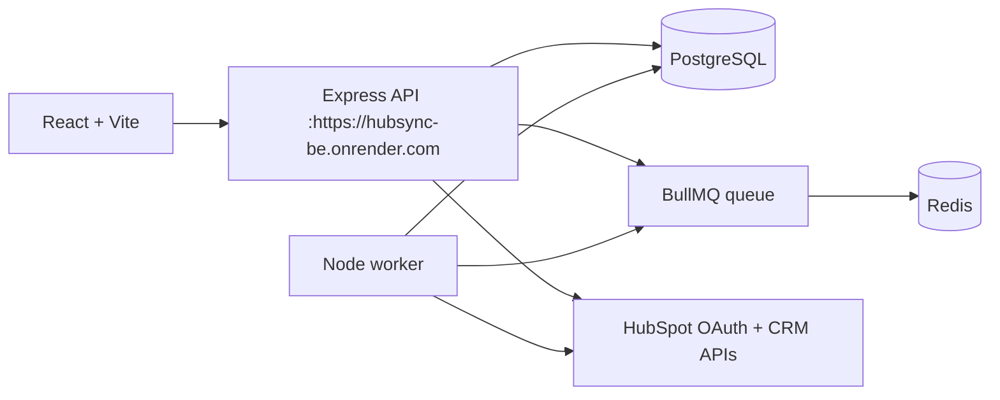
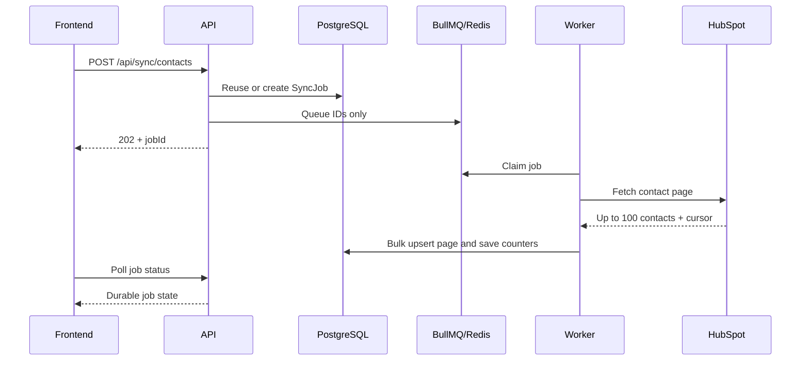

# HubSync architecture

HubSync is a small local-first application with a browser client, an HTTP API,
and a background worker. PostgreSQL is the durable source of truth. Redis and
BullMQ deliver work to the worker; they are not the public job-status store.

## Runtime layout



### Responsibilities

| Part | Responsibility |
| --- | --- |
| Frontend | Displays connection, contact, note, and job state; starts OAuth and sync actions. |
| API | Validates requests, manages OAuth and connections, writes local data, and creates jobs. |
| Worker | Processes contact and note jobs, calls HubSpot, and records progress. |
| PostgreSQL | Stores connections, encrypted tokens, contacts, notes, and sync jobs. |
| Redis/BullMQ | Delivers background jobs and handles retries. |
| HubSpot | Provides OAuth, contact data, and optional note writes. |

The API and worker are separate Node processes. The frontend development script
can start missing local API/frontend processes, but Redis and the worker must be
available for queued work.

## OAuth

1. The browser opens `GET /auth/hubspot`.
2. The API creates a random, single-use state value with a ten-minute lifetime.
3. HubSpot redirects to `/auth/hubspot/callback` with the authorization code.
4. The API exchanges the code, gets the portal ID, and encrypts both tokens with
   AES-256-GCM before storing them.
5. The API queues the first contact sync and redirects back to the frontend.

Tokens never go to the browser or into Redis. Access tokens are refreshed when
they are expired or within one minute of expiry. OAuth state and refresh locks
are process-local, so this implementation is intended for one API instance.

The required scopes are:

- `oauth`
- `crm.objects.contacts.read`
- `crm.objects.contacts.write`
- `crm.objects.notes.write`

## Data model

- **HubSpotConnection** — portal ID, encrypted tokens, token expiry, sync cursor,
  sync status, and last successful sync time.
- **Contact** — HubSpot contact ID, identity fields, raw properties, timestamps,
  and connection ID. `(connectionId, hubspotContactId)` is unique.
- **Note** — local note body, contact ID, optional HubSpot note ID, sync status,
  and the latest sync error.
- **SyncJob** — contact or note type, status, cursor, counters, attempts, error,
  and timestamps. Active work is deduplicated by connection or note.

All contact and note records belong to a connection. The current API requires
exactly one stored HubSpot connection because there is no application-user
model yet.

## Contact synchronization



The worker:

1. Gets a valid HubSpot access token.
2. Fetches pages using HubSpot's `after` cursor.
3. Reads existing IDs once and bulk upserts the page.
4. Saves the cursor and counters after each page.
5. Marks the job `COMPLETED`, `PARTIAL`, or lets the worker retry a transient
   failure.

The API returns quickly after creating or reusing the job. The frontend polls
with increasing intervals and refreshes contacts after a terminal result.
Contacts are listed newest-first by local `createdAt`, with the contact ID as a
stable tie-breaker.

## Notes

Notes are local-first:

1. The API validates the contact and note body.
2. The note is stored locally as `PENDING`.
3. If note sync is enabled, a `NOTES` job is queued without blocking the save
   response on Redis readiness.
4. The worker creates a HubSpot note and associates it with the contact using
   association type `202`.
5. A returned HubSpot ID changes the local note to `SYNCED`.

If queueing or HubSpot fails, the local note remains available. Ambiguous network
results are not automatically replayed because a duplicate HubSpot note could
be created.

## Queue and failure handling

- Queue payloads contain only database IDs.
- Jobs have four attempts with exponential backoff starting at two seconds.
- Completed jobs are retained for one day; failed jobs for seven days.
- Worker concurrency defaults to one and is capped at ten.
- BullMQ stalled-job recovery is enabled once.
- Contact writes are idempotent through the compound unique key.
- A saved cursor allows a later sync to resume at the failed page.
- HubSpot rate limits and transient server errors are retried.
- A revoked token becomes `AUTH_REQUIRED`.
- Unknown API errors return a generic message and are logged safely.

The database job row is the status read by the frontend. Redis is the transport,
so the two can briefly differ after a crash; enqueue recovery and idempotent
writes reduce the impact.

## API and frontend

The frontend uses `VITE_API_BASE_URL`, defaulting to
`https://hubsync-be.onrender.com`. Its API helper handles JSON parsing, API errors, and
network errors. Abort errors from replaced requests are ignored.

The API uses `FRONTEND_URL` for CORS. On local development, the same port is
also accepted on `localhost`, `127.0.0.1`, and `::1`. Non-local deployments are
restricted to the configured origin.

Main routes:

| Method | Route | Purpose |
| --- | --- | --- |
| `GET` | `/api/health` | API health response |
| `GET` | `/api/hubspot/status` | Connection and sync state |
| `GET` | `/api/contacts` | Search and paginate contacts |
| `POST` | `/api/sync/contacts` | Create or reuse a contact job |
| `GET` | `/api/sync/jobs/:jobId` | Read job progress |
| `POST` | `/api/contacts/:contactId/notes` | Create a local note |
| `GET` | `/api/contacts/:contactId/notes` | List notes |

## Security and boundaries

- OAuth tokens are encrypted before storage.
- Secrets are loaded only by the backend.
- Queue payloads do not contain tokens or credentials.
- Request bodies and user-provided IDs/search values are validated.
- CORS is not an open wildcard.
- There is no login or per-user authorization yet.
- OAuth state and token-refresh locking are not shared between API instances.

## Local operation

From `backend/`:

```powershell
npx prisma generate
npx prisma migrate deploy
npm run dev
```

In another backend terminal:

```powershell
npm run worker
```

From `frontend/`:

```powershell
npm run dev
```

Useful checks:

```powershell
Invoke-RestMethod https://hubsync-backend.onrender.com/api/health
npx prisma validate
npx prisma migrate status
npm run build
npm test
```

## Current limits

- One stored HubSpot connection is supported.
- There is no application authentication or tenant isolation.
- OAuth state and token-refresh locks are process-local.
- Notes can be created and read, but not edited or deleted.
- `/api/health` confirms that Express responds; it is not a full dependency
  health check.
- Production deployment, load testing, and operational monitoring are not part
  of this repository.
