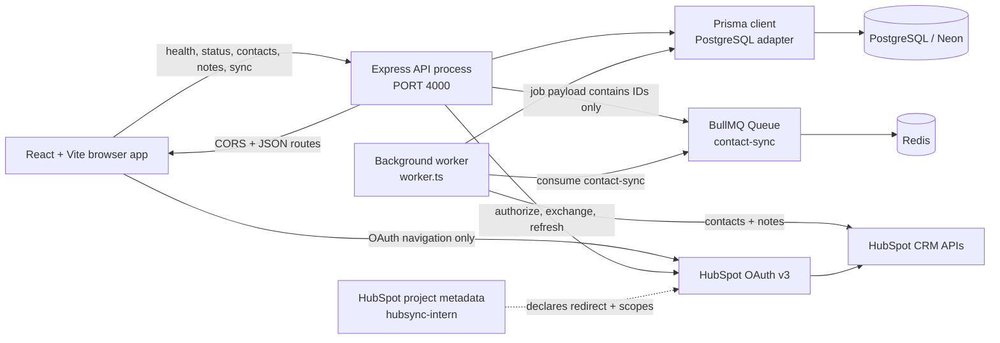
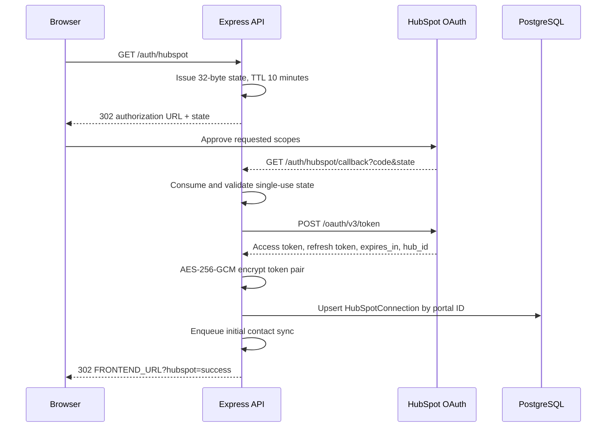
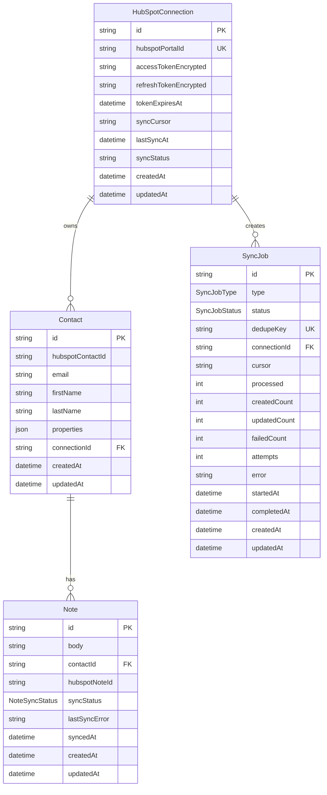
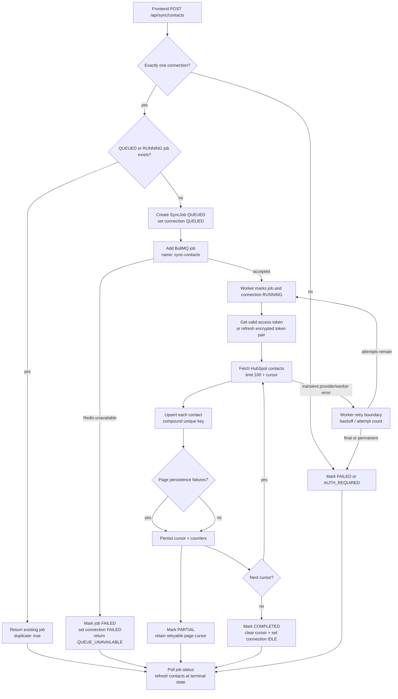
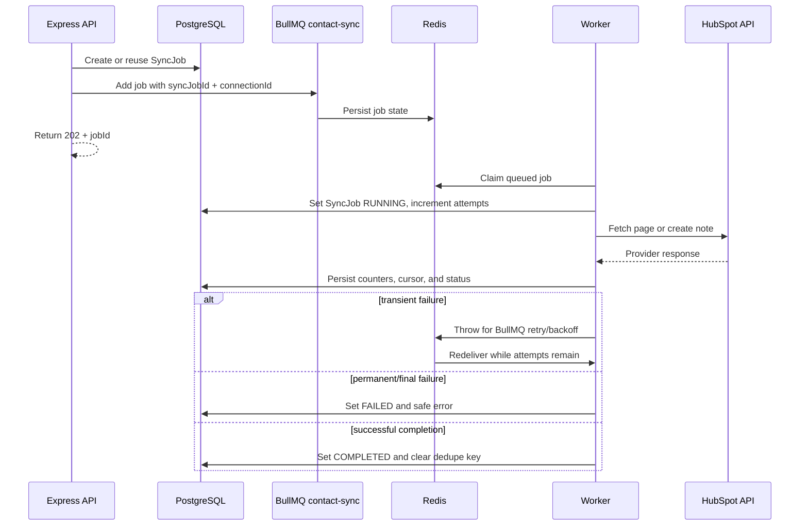
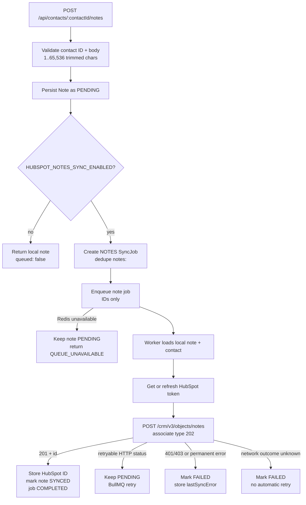
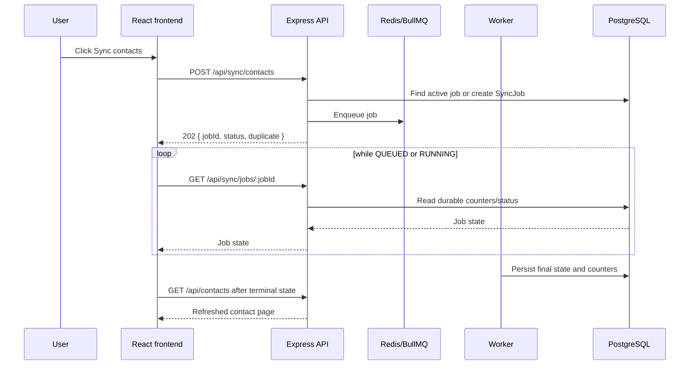

# HubSync architecture

This document describes the implementation in `D:\hubsync` as it exists in
the repository. It focuses on process boundaries, data ownership, queue
behavior, API contracts, and operational tradeoffs. It does not describe an
unimplemented multi-user or production platform.

## 1. System architecture

HubSync is composed of a browser frontend, an Express API, a PostgreSQL
database, Redis/BullMQ, a separate worker, and HubSpot's OAuth and CRM APIs.
The API owns request validation, OAuth, connection state, and job creation. The
worker owns long-running contact and note synchronization.



### Component responsibilities

| Component | Responsibility |
| --- | --- |
| Frontend | Renders the workspace, navigates to OAuth, calls the JSON API, polls jobs, and displays actual state. |
| Express API | Validates requests, enforces the single-connection operating model, persists local state, exposes status, and enqueues jobs. |
| OAuth service | Builds HubSpot authorization URLs, exchanges codes, introspects account IDs when needed, and upserts connections. |
| HubSpot API client | Handles token endpoints, contact pages, note creation, response parsing, retryable statuses, and safe provider errors. |
| Token service | Decrypts valid access tokens, refreshes near-expiry tokens, encrypts rotated tokens, and records authorization failure. |
| Contact sync service | Fetches HubSpot contact pages, refreshes tokens after a 401, upserts records, and persists cursor/counter state. |
| Notes service | Persists local notes, queues optional provider writes, associates notes to contacts, and records sync outcomes. |
| PostgreSQL/Prisma | Durable source of truth for connections, contacts, notes, and synchronization jobs. |
| Redis/BullMQ | Durable queue transport and worker coordination for contact and note jobs. |
| Worker | Consumes queue jobs, updates durable records, retries transient failures, and handles stalled jobs. |
| HubSpot project | Declares the private OAuth app, callback URL, required scopes, and permitted HubSpot API URL. |

The API and worker are independently launched Node processes. The frontend's
`frontend/scripts/dev.mjs` can start missing local processes, but the runtime
architecture remains two backend processes plus the browser.

## 2. OAuth implementation

### Authorization flow

1. The browser navigates to `GET /auth/hubspot`.
2. The API creates 32 random bytes encoded with `base64url` and stores the
   state in a process-local map for ten minutes.
3. The API redirects to `https://app.hubspot.com/oauth/authorize` with the
   client ID, requested scopes, exact redirect URI, and state.
4. HubSpot redirects to `/auth/hubspot/callback` with `code` and `state`.
5. The API consumes the state before accepting the code. A missing, expired, or
   reused state is rejected.
6. The backend exchanges the authorization code through HubSpot's v3 token
   endpoint.
7. The portal ID is read from `hub_id`; token introspection is used if the
   exchange response does not include a valid account ID.
8. Access and refresh tokens are encrypted with AES-256-GCM and upserted by
   `hubspotPortalId`.
9. A contact synchronization job is queued automatically.
10. The API redirects the browser back to `FRONTEND_URL` with a safe success or
    error indicator. Tokens never enter the browser.

Required scopes are declared in both backend code and HubSpot metadata:

- `oauth`
- `crm.objects.contacts.read`
- `crm.objects.contacts.write`
- `crm.objects.notes.write`



### Token storage and refresh

`TOKEN_ENCRYPTION_KEY` must decode to 32 bytes, either as base64 or as 64 hex
characters. The encrypted value has a version, IV, authentication tag, and
ciphertext separated by dots. The API selects the stored access token when it
has more than one minute remaining. Otherwise it decrypts the refresh token,
calls HubSpot, encrypts the new token pair, and stores a new expiry.

Refreshes are coalesced per connection inside one API process through an
in-flight promise map. This is not a distributed lock. A revoked refresh token
sets the connection to `AUTH_REQUIRED` and returns a controlled reconnect error.

## 3. Database schema

Prisma is configured with the PostgreSQL provider and
`@prisma/adapter-pg`. The schema has four application models and three enums.
The repository currently contains four committed migrations:

```text
20261025145645_init
20261025165515_add_sync_jobs
20261025165630_add_sync_job_dedupe_key
20261025175134_add_note_sync_jobs
```

### Models

#### `HubSpotConnection`

Stores the connected HubSpot portal, encrypted access and refresh tokens, token
expiry, the persisted contact cursor, current synchronization state, and last
successful contact sync time. `hubspotPortalId` is unique. It has one-to-many
relations to `Contact` and `SyncJob`.

#### `Contact`

Stores the local HubSpot contact ID, email, first name, last name, raw
properties JSON, connection ID, and timestamps. The compound unique constraint
`(connectionId, hubspotContactId)` is the idempotency boundary for contact
upserts. An index on `(connectionId, email)` supports connection-scoped lookup.
Contacts have a cascading relation to `HubSpotConnection` and a one-to-many
relation to `Note`.

#### `Note`

Stores a local note body and contact ID. `hubspotNoteId` is populated only after
HubSpot returns a note ID. `syncStatus` is the enum `PENDING`, `SYNCED`, or
`FAILED`; `lastSyncError` and `syncedAt` explain the latest external outcome.
The `(contactId, syncStatus)` index supports contact-scoped note operations.

#### `SyncJob`

Stores durable contact or note job state. It includes the enum type
(`CONTACTS` or `NOTES`), enum status (`QUEUED`, `RUNNING`, `COMPLETED`,
`PARTIAL`, `FAILED`), optional unique `dedupeKey`, connection ID, cursor,
processed/created/updated/failed counters, attempts, safe error text, and
started/completed timestamps. Indexes support connection/status and status/time
queries.



The database does not contain an application-user model. This is why the API
requires exactly one connection for connection-dependent operations and returns
a controlled conflict when more than one exists.

## 4. Contact synchronization flow

The contact sync API does not fetch HubSpot contacts during the HTTP request.
It creates or reuses a durable job and returns HTTP 202. The worker then owns
the provider calls and database writes.



### API-side deduplication

`enqueueContactSync` first searches for a connection-scoped `CONTACTS` job in
`QUEUED` or `RUNNING`. If one exists, it returns that job and marks the result
as a duplicate. If no job exists, the API creates a `SyncJob` with
`dedupeKey=contacts:<connectionId>` inside a transaction that also marks the
connection `QUEUED`.

The unique dedupe key and the retry lookup protect the create race between two
requests. If the database row exists but its Redis job is missing, the API
re-adds a BullMQ job using the durable job ID.

### Worker execution

The worker starts each job by incrementing `attempts`, setting `RUNNING`, and
setting the connection sync state to `RUNNING`. It reads the job cursor first,
then falls back to the connection cursor for a resumed page. A 401 from the
Contacts API triggers one forced token refresh and a retry of the same page.

After each page, the worker persists the cursor and counters. A page with local
database persistence failures becomes `PARTIAL`; the cursor remains at the
failed page so a later job can safely retry it. A completed final page clears
the cursor, sets the connection to `IDLE`, records `lastSyncAt`, and marks the
job `COMPLETED`.

## 5. Background processing strategy

The queue is named `contact-sync`. Both contact and note jobs use the queue
job name `sync-contacts`; the durable `SyncJob.type` and payload determine
whether the worker calls contact or note processing.

Queue payloads contain identifiers only:

```text
ContactSyncJobData = { syncJobId, connectionId }
NoteSyncJobData    = { syncJobId, connectionId, noteId }
```

OAuth tokens, database URLs, and other secrets are never placed in Redis job
payloads. The worker reads encrypted tokens from PostgreSQL and decrypts them
only when needed.

Queue defaults in `syncJobs.ts` are:

- 4 total attempts.
- Exponential backoff with a 2,000 ms starting delay.
- Completed jobs retained for up to one day, bounded by count.
- Failed jobs retained for up to seven days, bounded by count.

The worker clamps `SYNC_WORKER_CONCURRENCY` to a maximum of 10 and defaults to
1. BullMQ uses a 30-second stalled interval and permits one stalled recovery
through `maxStalledCount: 1`.



The worker has explicit startup and shutdown behavior. It connects to Redis
with a fail-fast five-second startup race, closes the BullMQ worker and Redis
connection on termination, and disconnects Prisma. The API has matching
shutdown handling for its HTTP server, lazily created queue, and Prisma client.

The queue is at-least-once in practical operation: jobs can be retried or
re-delivered after a worker interruption. The application does not claim
exactly-once delivery. Idempotent contact upserts and durable cursors reduce the
effect of duplicate processing. Note creation is intentionally more cautious:
an ambiguous network result is marked failed rather than automatically
replayed, because a replay could create a duplicate HubSpot note.

## 6. Notes synchronization

The notes path uses the same BullMQ queue but a different durable job type and
dedupe key. A note is written locally before any external request. This makes
the local note available even when Redis or HubSpot is unavailable.



The provider request uses:

- `POST https://api.hubapi.com/crm/v3/objects/notes`.
- `hs_timestamp` from the local note creation time.
- `hs_note_body` from the validated local body.
- The HubSpot contact ID in `associations.to.id`.
- HubSpot-defined association type `202`.

The local note's synchronization states are `PENDING`, `SYNCED`, and `FAILED`.
The frontend exposes creation and retrieval only because the backend has no
edit or delete routes.

## 7. API and frontend integration

The frontend obtains its base URL from `import.meta.env.VITE_API_BASE_URL`,
defaulting to `http://localhost:4000`. `apiFetch` centralizes JSON parsing,
`Accept`/`Content-Type` headers, API error extraction, and network-error
classification. Abort errors are allowed to propagate so component cleanup is
not displayed as a backend outage.

The backend uses `FRONTEND_URL` as its single CORS origin. The default browser
origin is `http://localhost:5173`; a different Vite port requires matching
backend configuration.

The React application:

- Loads `/api/health` and `/api/hubspot/status` on startup.
- Loads contacts with `page`, `limit`, and `search` query parameters.
- Debounces contact search by 350 ms.
- Uses `AbortController` when contact, note, or sync requests are replaced or
  the component unmounts.
- Navigates the browser to `/auth/hubspot` for OAuth; it never exchanges codes
  or handles token values.
- Posts a contact sync request, reads `jobId`, waits 1.2 seconds between status
  requests, stops at a terminal job state, and refreshes the connection and
  contact list.
- Displays actual counters returned by the API. Active progress is shown as an
  indeterminate bar because the backend does not expose a total-record count
  for percentage calculation.
- Creates a local note, then polls its returned note job when queueing is
  enabled, and reloads the contact's notes after the terminal result.



## 8. Error handling and retry strategy

Known application errors use `AppError` and are returned with their status code
and safe error code/message. Unknown errors are logged with a generic message
and returned as `INTERNAL_SERVER_ERROR`; internal stack traces, tokens, and
connection details are not returned.

| Failure category | Handling | Retry behavior | Final status |
| --- | --- | --- | --- |
| Invalid pagination, search, job ID, contact ID, or note body | Route validation raises `VALIDATION_ERROR` | No retry | HTTP 400 |
| Missing or invalid OAuth state | Callback rejects the state and redirects with an OAuth error indicator | No retry | OAuth error redirect / HTTP 400 before redirect |
| No connection or multiple connections | Connection context rejects the operation | No automatic retry | `HUBSPOT_NOT_CONNECTED` or `MULTIPLE_CONNECTIONS` |
| Missing/invalid configuration | Configuration is validated when the workflow needs it | No automatic retry | `CONFIGURATION_ERROR` |
| HubSpot 401 during contact/note API call | Contact flow forces one token refresh and retries; token revocation becomes `AUTH_REQUIRED` | Refresh once, then worker policy | `AUTH_REQUIRED` connection state or final job failure |
| HubSpot 423, 429, 477, 500, 502, 503, 504, 521–526 | HubSpot client honors `Retry-After` and uses bounded exponential delay | Up to four provider attempts by default | Provider error reaches BullMQ retry boundary if still failing |
| HubSpot network failure for normal requests | HubSpot client retries unless disabled | Up to four client attempts | `HubSpotApiError` after final attempt |
| HubSpot note network outcome is ambiguous | Note creation disables network retries to avoid duplicate notes | No automatic replay | Note `FAILED`, code `NOTE_SYNC_AMBIGUOUS` |
| HubSpot note permission or permanent failure | Note remains local and records `lastSyncError` | No retry for permission/permanent classes | Note `FAILED` |
| Redis unavailable while queueing | Queue readiness wait is bounded at 3.5 seconds | No synchronous fallback | `QUEUE_UNAVAILABLE`; local note remains pending |
| Worker failure before final attempt | Worker persists a safe error and throws for BullMQ | BullMQ exponential backoff, 4 total attempts by default | Job returns to `QUEUED` or becomes `FAILED` |
| Worker stalled job | BullMQ stalled detection can requeue work | One stalled recovery configured | Final worker failure becomes `FAILED` |
| Contact persistence failure within a page | Cursor remains at the page and counters persist | Job is marked `PARTIAL`; a later sync can retry the page | `PARTIAL` |
| Frontend request cancellation | `AbortController` stops replaced/unmounted work | No retry | No user-facing network error for cancellation |

HubSpot retry status handling is separate from BullMQ retry handling. The
provider client handles HTTP-level retryable responses first; errors that
escape that layer are then governed by worker attempts and backoff.

## 9. Scalability approach

The current scaling model provides a safe foundation but is not a measured
high-throughput system:

- API and worker processes are separate and can be supervised independently.
- Redis separates request latency from contact import work.
- Worker concurrency is configurable from 1 through 10.
- PostgreSQL stores durable job state and allows frontend polling without
  depending only on ephemeral Redis metadata.
- Contact upserts use a compound uniqueness constraint, making repeated page
  processing idempotent at the record key.
- Cursor persistence allows a resumed job to start from the last durable page.
- Provider retries and BullMQ retries handle different failure boundaries.
- The current connection model deliberately supports one connection rather than
  making unsafe multi-tenant assumptions.

The implementation does not claim a throughput target, exactly-once delivery,
or horizontal multi-instance OAuth safety. Real scaling would require measured
load tests, batch database operations, shared coordination, user/tenant
ownership, and operational observability.

## 10. Design decisions and tradeoffs

### PostgreSQL for durable state

Connections, encrypted token material, contacts, notes, and job counters must
survive process restarts. PostgreSQL provides relational constraints and
transactions for this state. The tradeoff is a database dependency for local
startup and migrations.

### Prisma for database access

Prisma provides typed models, migrations, compound unique keys, and transaction
APIs. The project uses Prisma 7's PostgreSQL adapter configuration rather than
embedding a database URL in the schema. The tradeoff is generated-client and
migration tooling that must remain aligned with the schema.

### Redis/BullMQ for background work

HubSpot imports can involve many pages and external latency. A queue keeps
requests short and allows retries/stalled-job recovery. The tradeoff is an
additional service and the need to run a worker separately.

### Encrypted OAuth tokens

Tokens are needed for future API calls but must not be stored as plaintext.
AES-256-GCM provides confidentiality and tamper detection when the encryption
key is protected. The key itself remains an environment secret; losing it makes
stored token values undecryptable.

### Database-backed jobs plus Redis transport

Redis is the delivery mechanism, while PostgreSQL is the durable public status
record. This lets the frontend read counters and errors consistently after
worker restarts. The tradeoff is that database and queue state can temporarily
diverge and must be reconciled by the enqueue/retry logic.

### Process-local coordination

OAuth state and token-refresh locks use process-local memory, which is simple
and appropriate for the current single-instance MVP. It is not sufficient for
multiple API instances without a shared state/lock service.

## 11. Security considerations

- Tokens are encrypted with AES-256-GCM before database persistence.
- Tokens are not returned by any registered API response or placed in queue
  payloads.
- OAuth state is random, single-use, and expires after ten minutes.
- The callback validates the path and requires HTTPS outside localhost.
- CORS is restricted to the configured `FRONTEND_URL`, not an open wildcard.
- JSON request bodies are limited to 100 KB.
- Note, contact, search, page, limit, and job ID inputs are validated.
- OAuth code exchange and refresh happen only in backend modules.
- Unknown errors return generic messages instead of internal exception details.
- Logs use safe status/error metadata; provider tokens are not structured log
  fields.
- Queue payloads carry database identifiers, not credentials.
- PostgreSQL foreign keys and uniqueness constraints prevent cross-connection
  contact access and duplicate local contact keys.

Important protections are still absent:

- There is no application login, session, or user authorization layer.
- A caller who can reach this development API is not identified as a user.
- OAuth state is not shared across API instances.
- Refresh locking is not distributed.
- The root `hubspot.config.yml` is an existing local HubSpot CLI configuration;
  secrets must be managed and rotated outside documentation and source files.

The application should not be described as production-secure until those
application-authentication and deployment-secret concerns are addressed.

## 12. Operational workflows

### Local startup order

1. Ensure PostgreSQL/Neon is reachable.
2. Start Redis or the `hubsync-redis` Docker container.
3. From `backend/`, generate the Prisma client and deploy/check committed
   migrations.
4. Start `npm run dev` for the API.
5. Start `npm run worker` in a second backend terminal.
6. Start `npm run dev` from `frontend/`, or use the orchestrator to start/reuse
   missing services.
7. Open the frontend and verify `/api/health` and connection status.

### Useful operational checks

```powershell
# API health
Invoke-RestMethod http://localhost:4000/api/health

# Connection state
Invoke-RestMethod http://localhost:4000/api/hubspot/status

# Prisma schema and migration state
Set-Location D:\hubsync\backend
npx prisma validate
npx prisma migrate status

# Build/test checks
npm run build
npm test
```

For a queued synchronization, record the `jobId` returned by
`POST /api/sync/contacts` and query `GET /api/sync/jobs/:jobId`. The response
contains status, attempts, cursor, processed/created/updated/failed counters,
safe error text, and timestamps.

## 13. Verification summary

The most recent completed implementation verification reported the following:

- `npx prisma generate` passed.
- `npx prisma validate` passed.
- `npx prisma migrate status` reported four migrations and an up-to-date
  database.
- `npm run build` passed in `backend/`.
- `npm test` passed all 12 backend tests.
- `npm run build` passed in `frontend/`.
- `npm run lint` passed in `frontend/`.
- `node --check scripts/dev.mjs` passed.
- HubSpot metadata JSON validation passed.
- `GET /api/health` returned HTTP 200.
- CORS allowed `http://localhost:5173`.
- `GET /api/hubspot/status` returned a connected account.
- Redis returned `PONG`.
- The worker process was running and the queue had no active or failed jobs at
  the time of inspection.
- A real contact synchronization completed with 63 processed, 0 created, 63
  updated, and 0 failed.
- Contact listing, search, pagination, and notes retrieval were verified.
- An existing note was `SYNCED` and contained a HubSpot note ID and `syncedAt`.

The following were not repeated during documentation work:

- A fresh full browser OAuth consent/callback flow.
- Creation of a new external HubSpot note.
- Production deployment, load testing, and multi-instance behavior.
