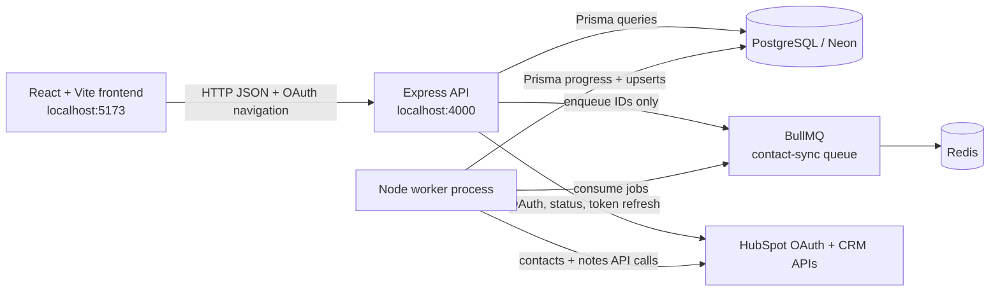

# HubSync

HubSync is a local-first HubSpot CRM synchronization workspace. It connects a
HubSpot account through OAuth, imports HubSpot contacts into PostgreSQL, and
provides a React dashboard for inspecting contacts, synchronization state, and
local notes.

The application deliberately separates HTTP request handling from background
work. The Express API creates durable synchronization records and enqueues
BullMQ jobs in Redis. A separate worker consumes those jobs, calls HubSpot, and
persists progress and results through Prisma. This keeps long-running contact
imports out of the request/response path and makes job state visible to the
frontend.

The canonical technical design is documented in
[`ARCHITECTURE.md`](./ARCHITECTURE.md).

## Project overview

HubSync has three application areas:

- **Backend API** — Express 5 and TypeScript, with Prisma 7 and PostgreSQL for
  durable state, HubSpot OAuth/API integration, Redis/BullMQ queueing, and a
  separate worker process.
- **Frontend** — React 19 and Vite, using the browser Fetch API against the
  backend. It displays actual connection, contact, note, and job state rather
  than seeded or simulated CRM records.
- **HubSpot developer project** — `hubsync-intern/` contains the HubSpot project
  metadata, OAuth app declaration, required scopes, permitted HubSpot API URL,
  and the existing CRM card starter project.

### What is synchronized

Contact synchronization reads HubSpot CRM contacts in pages of up to 100
records, follows HubSpot's `paging.next.after` cursor, and upserts each record
using the compound key `(connectionId, hubspotContactId)`. The local database
stores contact identity fields and the returned property JSON. A synchronization
job stores its cursor, counters, status, timestamps, and safe error text so the
frontend can poll it after receiving HTTP `202 Accepted`.

Notes are stored locally first and belong to a local contact. When
`HUBSPOT_NOTES_SYNC_ENABLED=true`, the note is also queued for the worker. The
worker creates a HubSpot note using the Notes API, associates it with the
HubSpot contact, stores the returned HubSpot note ID, and marks the local note
`SYNCED`. Local notes remain available when queueing or external synchronization
fails. The backend currently supports note creation and retrieval; edit and
delete endpoints are not implemented.

## Key features

Implemented and verified in the current codebase:

- HubSpot OAuth authorization-code flow.
- Single-use, ten-minute, process-local OAuth state validation.
- AES-256-GCM encryption for stored access and refresh tokens.
- Access-token refresh with refresh-token rotation when HubSpot returns a new
  refresh token.
- PostgreSQL persistence through Prisma 7 and `@prisma/adapter-pg`.
- Contact listing, case-insensitive search, pagination, and refresh.
- Idempotent contact upserts protected by a compound uniqueness constraint.
- Redis and BullMQ background synchronization on the `contact-sync` queue.
- Durable synchronization job records with `QUEUED`, `RUNNING`, `COMPLETED`,
  `PARTIAL`, and `FAILED` states.
- Duplicate active contact-job detection and queue-job recovery when a durable
  active job has no corresponding Redis job.
- Bounded HubSpot retries for rate limits and transient service failures.
- Separate worker process with configurable, capped concurrency and stalled-job
  handling.
- Local note creation and retrieval with `PENDING`, `SYNCED`, and `FAILED`
  note synchronization states.
- Optional HubSpot note creation and contact association.
- Frontend dashboard, connection status, backend health, contact details, notes,
  polling, loading states, empty states, validation messages, and safe API
  errors.
- API and worker shutdown paths that close their owned resources.

The implementation does **not** provide application-user authentication,
session management, or multi-user connection ownership. Those are documented as
limitations rather than presented as completed features.

## Architecture overview



See [`ARCHITECTURE.md`](./ARCHITECTURE.md) for the detailed process, data,
queue, OAuth, and error-flow diagrams.

## Technology stack

| Area | Technology | Role |
| --- | --- | --- |
| Runtime | Node.js, TypeScript, npm | Backend, worker, and frontend tooling |
| API | Express 5 | JSON API, OAuth routes, CORS, body limits, error handling |
| Frontend | React 19, Vite 8 | CRM workspace UI and API polling |
| Styling | Tailwind CSS Vite plugin, project CSS, Lucide React | UI styling and icons |
| Database | PostgreSQL, Prisma 7, `@prisma/adapter-pg` | Durable connections, contacts, notes, and job records |
| Queue | Redis, BullMQ 6, ioredis | Asynchronous contact and note synchronization |
| Provider | HubSpot OAuth v3 and CRM APIs | Authorization, contact reads, and note writes |
| Local Redis | Docker Desktop with `redis:7-alpine` | Optional local Redis service |

The API uses Node's built-in `fetch` for HubSpot requests. Prisma is used for
typed database access, while Redis/BullMQ prevents long-running imports from
blocking HTTP requests.

## Repository structure

```text
D:\hubsync\
├── README.md                         # Canonical project entry point
├── ARCHITECTURE.md                   # Canonical technical architecture
├── backend/
│   ├── src/
│   │   ├── routes/                   # Express route modules
│   │   ├── services/                 # OAuth, tokens, sync, contacts, notes
│   │   ├── lib/                      # Prisma, Redis, crypto, HubSpot client
│   │   ├── middleware/               # Safe JSON error responses
│   │   ├── app.ts                    # Express app composition
│   │   ├── server.ts                 # API process and shutdown handling
│   │   └── worker.ts                 # BullMQ worker process
│   ├── prisma/                       # Schema and database migrations
│   ├── prisma7.config.ts             # Prisma datasource/migration config
│   ├── .env.example                  # Backend environment template
│   └── package.json                  # API, worker, build, and test scripts
├── frontend/
│   ├── src/                          # React application and API client
│   ├── scripts/dev.mjs               # Reuses or starts local services
│   ├── .env.example                  # Browser-safe API URL template
│   └── package.json                  # Vite, build, and lint scripts
├── hubsync-intern/
│   ├── hsproject.json                # HubSpot project metadata
│   └── src/app/                      # OAuth app metadata and CRM card starter
└── hubspot.config.yml                # Existing local HubSpot CLI configuration
```

Important backend directories:

- `backend/src/routes/` registers health, OAuth, connection, contacts, sync,
  and notes endpoints.
- `backend/src/services/` contains the application workflows, including token
  refresh, contact synchronization, note synchronization, and queue creation.
- `backend/src/lib/` contains shared infrastructure and provider code. Token
  encryption and HubSpot API calls are kept out of route modules.
- `backend/src/middleware/` converts known application errors and unknown errors
  into safe JSON responses.
- `backend/prisma/` contains the PostgreSQL schema and four existing migration
  directories.
- `backend/src/worker.ts` is a separately launched BullMQ consumer.
- `frontend/src/` contains the React application, API types, centralized fetch
  helper, views, polling, and UI state.
- `frontend/scripts/` contains the Windows-compatible development process
  orchestrator.
- `hubsync-intern/` is the HubSpot developer-project area; it is not the main
  React frontend and does not replace the Express API.

## Prerequisites

- Windows PowerShell or Windows Terminal for the commands below.
- Node.js 20 or newer. The current frontend setup explicitly targets Node 20+
  and the verified environment used Node 24.
- npm, installed with Node.js.
- A PostgreSQL database. The project supports a managed Neon PostgreSQL
  connection through `DATABASE_URL`.
- Redis reachable through `REDIS_URL`.
- Docker Desktop is optional but convenient for local Redis.
- A HubSpot developer account and a private OAuth app with the scopes declared
  in `hubsync-intern/src/app/app-hsmeta.json`.
- A HubSpot test account installed with that app when running real OAuth,
  contact, or note synchronization.

## Environment variables

The backend reads its `.env` from `backend/` through `dotenv/config`. The
frontend only exposes the browser-safe backend base URL through Vite. Never put
backend credentials, access tokens, refresh tokens, database URLs, or the token
encryption key in frontend variables.

| Variable | Component | Purpose | Required |
| --- | --- | --- | --- |
| `PORT` | Backend | Express API listening port; defaults to `4000` in code | No, defaults to `4000` |
| `DATABASE_URL` | Backend / Prisma | PostgreSQL or Neon connection URL | Yes |
| `REDIS_URL` | Backend API / worker | Redis connection used by BullMQ and queue operations | Yes when queueing or running the worker |
| `HUBSPOT_CLIENT_ID` | Backend | HubSpot OAuth application client ID | Yes for OAuth and token refresh |
| `HUBSPOT_CLIENT_SECRET` | Backend | HubSpot OAuth application client secret | Yes for OAuth and token refresh |
| `HUBSPOT_REDIRECT_URI` | Backend | Exact OAuth callback URL | Yes for OAuth |
| `FRONTEND_URL` | Backend | Allowed CORS origin and OAuth result redirect target | Yes for OAuth and browser integration |
| `TOKEN_ENCRYPTION_KEY` | Backend | 32-byte base64 or 64-character hex AES-256-GCM key | Yes when encrypting/decrypting tokens |
| `HUBSPOT_NOTES_SYNC_ENABLED` | Backend / worker | Enables queued HubSpot note writes when `true` | No; defaults to disabled behavior |
| `SYNC_WORKER_CONCURRENCY` | Worker | Worker concurrency; code clamps it to a maximum of 10 | No; defaults to `1` |
| `VITE_API_BASE_URL` | Frontend | Browser-visible backend base URL, normally `http://localhost:4000` | No; frontend defaults to that URL |
| `NODE_ENV` | Backend | Controls Prisma's development global-client reuse behavior | No |

Use the existing templates without committing real values:

```powershell
Copy-Item .\backend\.env.example .\backend\.env
Copy-Item .\frontend\.env.example .\frontend\.env
```

The templates contain placeholders only. Generate a token encryption key with:

```powershell
node -e "console.log(require('node:crypto').randomBytes(32).toString('base64'))"
```

Place the result only in `backend/.env`. Do not print or commit the real key.

## Installation and local development

The following workflow is safe for the existing database. It uses
`prisma migrate deploy` to apply committed migrations and does not reset or
drop data.

### 1. Install dependencies

From the repository root:

```powershell
Set-Location D:\hubsync\backend
npm install

Set-Location D:\hubsync\frontend
npm install
```

The `hubsync-intern/` directory is a HubSpot developer project. Use the
HubSpot CLI only when working on that project itself; it is not required for
the local React/Express application to start.

When working on the HubSpot developer project, the separate prerequisites are
an active HubSpot account, the HubSpot CLI, and developer-project access. From
that directory, the existing project workflow is:

```powershell
Set-Location D:\hubsync\hubsync-intern
hs project dev
```

This command is for the HubSpot project/card iteration workflow. It does not
start the Express API, BullMQ worker, or main React frontend.

### 2. Configure the backend and frontend

Create `backend/.env` and `frontend/.env` from the templates as shown above.
For the default local setup, confirm these non-secret values:

```env
# backend/.env
PORT=4000
HUBSPOT_REDIRECT_URI=http://localhost:4000/auth/hubspot/callback
FRONTEND_URL=http://localhost:5173

# frontend/.env
VITE_API_BASE_URL=http://localhost:4000
```

Use the real PostgreSQL/Neon URL, Redis URL, HubSpot credentials, and encryption
key in `backend/.env`. Do not replace an existing working `.env` merely to
follow this example.

### 3. Start Redis

Redis is required for contact and enabled note queueing. With Docker Desktop:

```powershell
docker start hubsync-redis
```

If the container does not exist yet, create it once:

```powershell
docker run --name hubsync-redis -p 6379:6379 -d redis:7-alpine
```

A managed Redis-compatible service can be used instead by setting
`REDIS_URL`.

### 4. Prepare Prisma safely

From `backend/`:

```powershell
Set-Location D:\hubsync\backend
npx prisma generate
npx prisma migrate deploy
npx prisma migrate status
```

`migrate deploy` applies any of the four committed migrations that are not yet
applied. Do not use `prisma migrate reset`, `prisma db push`, or other
destructive commands against the populated database as routine setup.

### 5. Start the API and worker

The API and worker are separate processes. Run them in separate terminals when
you want direct process visibility.

**Terminal 1 — API:**

```powershell
Set-Location D:\hubsync\backend
npm run dev
```

The API listens on `http://localhost:4000` by default. Production-style
startup is available through `npm start` after `npm run build`.

**Terminal 2 — worker:**

```powershell
Set-Location D:\hubsync\backend
npm run worker
```

The worker connects to Redis, consumes `contact-sync`, and processes both
contact and enabled note jobs. It exits quickly with a startup error when Redis
cannot be reached.

### 6. Start the frontend

From `frontend/`:

```powershell
Set-Location D:\hubsync\frontend
npm run dev
```

`frontend/scripts/dev.mjs` checks for the API health response and the Vite app
on port `5173`. It starts only the missing local process, so it can be used as
the normal development entry point. The intended browser URL is
`http://localhost:5173`.

If port `5173` is already occupied by another frontend, stop that process or
run the API and frontend in separate terminals with a matching `FRONTEND_URL`
and CORS configuration. Vite may otherwise choose another port while the
backend is still configured to allow only the configured frontend origin.

### 7. Verify the local stack

API health:

```powershell
Invoke-RestMethod http://localhost:4000/api/health
```

Expected response:

```json
{
  "success": true,
  "message": "HubSync API is running"
}
```

Then open `http://localhost:5173`, check **API status**, and confirm that the
backend health and connection status reflect the actual API responses.

## Troubleshooting

### Redis connection failures

- Confirm the Redis service or `hubsync-redis` container is running.
- Confirm `REDIS_URL` is present in `backend/.env` and points to the reachable
  Redis instance.
- The API waits up to 3.5 seconds when queueing before returning
  `QUEUE_UNAVAILABLE`.
- The worker uses a fail-fast connection and exits after its startup timeout;
  restart it after correcting Redis connectivity.

### Port 4000 is already in use

- Inspect the process that owns port 4000 and stop the duplicate development
  API, or choose a different `PORT`.
- If `PORT` changes, update `VITE_API_BASE_URL`, `HUBSPOT_REDIRECT_URI`,
  `FRONTEND_URL` as appropriate, and the HubSpot app redirect URL together.
- Do not start a second API on the same port.

### Port 5173 is already in use

- Reuse the existing frontend if it is the HubSync Vite app.
- Otherwise stop the conflicting process before using the orchestrated frontend
  command, or make the frontend port and backend `FRONTEND_URL` agree.
- CORS is intentionally limited to the configured `FRONTEND_URL`.

### Missing environment variables

The backend validates `DATABASE_URL` when Prisma is initialized and validates
HubSpot, frontend URL, Redis, and encryption configuration at the workflow that
needs each value. Use the exact variable names in the environment table. Never
copy secrets into frontend files.

### Prisma client or migration issues

Run the non-destructive preparation commands again:

```powershell
Set-Location D:\hubsync\backend
npx prisma generate
npx prisma validate
npx prisma migrate status
```

If the database is unreachable, fix the network or managed database connection
first. Do not reset the database to resolve a connection or migration-status
problem.

### HubSpot OAuth redirect mismatch

The local redirect must be exactly:

```text
http://localhost:4000/auth/hubspot/callback
```

It must match `HUBSPOT_REDIRECT_URI`, the HubSpot app configuration, and the
metadata in `hubsync-intern/src/app/app-hsmeta.json`. The backend validates the
callback path and requires HTTPS for non-localhost URLs.

### Missing HubSpot scopes or expired tokens

The application requests `oauth`, contact read/write, and notes write scopes.
If the HubSpot app's scopes change, reconnect the account so the stored
authorization reflects the new permissions. A revoked refresh token is exposed
as an `AUTH_REQUIRED` connection state and requires reconnection.

### Failed or queued synchronization jobs

- `QUEUED` means the API accepted the job but a worker has not completed it.
- Confirm `npm run worker` is running and connected to the same Redis instance.
- Inspect `GET /api/sync/jobs/:jobId` for counters, attempts, cursor, error,
  and terminal status.
- `PARTIAL` means one or more contact persistence operations failed; the job
  retains a cursor and reports a safe error.
- `FAILED` means retries were exhausted or a permanent failure occurred.
- Do not manually delete database rows or Redis jobs to hide a failure.

### CORS errors in the browser

Confirm that the browser origin, `FRONTEND_URL`, and the Vite port agree. The
default pairing is `http://localhost:5173` and `http://localhost:4000`.

## API reference

All JSON API responses use a `success` flag. Successful data is normally under
`data`; known failures use an `error` object with a safe `code` and `message`.

### Health, OAuth, and connection routes

| Method | Endpoint | Purpose | Request/response notes |
| --- | --- | --- | --- |
| `GET` | `/api/health` | API health check | Returns `{ success, message }`; does not perform a full dependency health check. |
| `GET` | `/auth/hubspot` | Start OAuth | Creates state and redirects to HubSpot's authorization URL. |
| `GET` | `/auth/hubspot/callback` | Complete OAuth | HubSpot-only callback; validates state, stores encrypted tokens, and queues an initial contact sync. |
| `GET` | `/api/hubspot/status` | Read connection state | Returns `connected`, `connectionCount`, `portalId`, `syncStatus`, and `lastSyncAt`; multiple connections return HTTP 409. |
| `GET` | `/api/hubspot` | Alternate OAuth mount | The HubSpot router is also mounted at `/api`; the frontend uses `/auth/hubspot`. |
| `GET` | `/api/hubspot/callback` | Alternate callback mount | Same router behavior as above; the configured redirect uses `/auth/hubspot/callback`. |

Example:

```powershell
Invoke-RestMethod http://localhost:4000/api/hubspot/status
```

### Contacts and synchronization routes

| Method | Endpoint | Purpose | Request/response notes |
| --- | --- | --- | --- |
| `GET` | `/api/contacts?page=1&limit=25&search=ada` | List local contacts | `page` defaults to 1, `limit` defaults to 25 and is capped at 100, and `search` matches email, first name, or last name. |
| `POST` | `/api/sync/contacts` | Enqueue a contact sync | Requires one connection; returns HTTP 202 with `jobId`, initial `status`, and `duplicate`. |
| `GET` | `/api/sync/jobs/:jobId` | Read job state | Returns type, status, counters, attempts, cursor, safe error, and timestamps. |

Start a synchronization:

```powershell
$job = Invoke-RestMethod `
  -Method Post `
  -Uri http://localhost:4000/api/sync/contacts

$job.data
```

The response has this shape:

```json
{
  "success": true,
  "data": {
    "jobId": "job-id",
    "status": "QUEUED",
    "duplicate": false
  }
}
```

Poll the returned job ID until `COMPLETED`, `PARTIAL`, or `FAILED`:

```powershell
Invoke-RestMethod http://localhost:4000/api/sync/jobs/job-id
```

### Notes routes

| Method | Endpoint | Purpose | Request/response notes |
| --- | --- | --- | --- |
| `POST` | `/api/contacts/:contactId/notes` | Create a local note | JSON body is `{ "body": "..." }`; validates non-empty text up to 65,536 characters. |
| `GET` | `/api/contacts/:contactId/notes` | List notes | Verifies contact ownership and returns notes newest first. |

Example request:

```powershell
Invoke-RestMethod `
  -Method Post `
  -Uri http://localhost:4000/api/contacts/contact-id/notes `
  -ContentType 'application/json' `
  -Body '{"body":"Follow up with the customer next week."}'
```

No edit or delete note endpoints are registered. Unknown paths return a JSON
404 response with code `NOT_FOUND`.

## Contact synchronization

The complete lifecycle is:

1. The frontend sends `POST /api/sync/contacts`.
2. The API requires exactly one stored HubSpot connection.
3. An active `QUEUED` or `RUNNING` contact job is reused and returned with
   `duplicate: true`; otherwise a durable `SyncJob` row is created.
4. The API adds a BullMQ job named `sync-contacts` to the `contact-sync` queue.
5. The worker marks the job and connection `RUNNING` and obtains a valid access
   token, refreshing it when it is expired or within the one-minute expiry
   skew.
6. HubSpot contacts are fetched in pages of 100 records using the `after`
   cursor.
7. Each record is upserted using `(connectionId, hubspotContactId)`.
8. The cursor and counters are persisted after every page.
9. The job reaches `COMPLETED` after the final page, or `PARTIAL` when a page
   contains persistence failures. Retryable worker/provider errors return the
   job to `QUEUED` until the attempt limit is reached.
10. The frontend polls the job endpoint and refreshes connection/contact data
    only after the job reaches a terminal state.

The `202 Accepted` response means the job was accepted and queued; it does not
mean that HubSpot synchronization has completed.

## Notes management

The note workflow is intentionally local-first:

1. The API validates the contact ID and note body.
2. It verifies that the contact belongs to the current connection.
3. It persists the note locally as `PENDING`.
4. If note sync is disabled, it returns the local note without queueing an
   external write.
5. If enabled, it creates a `NOTES` sync job with a `notes:<noteId>` dedupe key.
6. The worker calls `POST /crm/v3/objects/notes` with `hs_timestamp` and
   `hs_note_body`, and associates the note to the HubSpot contact with
   association type `202`.
7. A returned HubSpot note ID is saved before the local note becomes `SYNCED`.

Transient HubSpot HTTP failures remain retryable. Permission failures become
`FAILED` while preserving the local note. A network failure during note
creation is treated as ambiguous and is not automatically retried because the
request may have reached HubSpot already.

## Testing and quality checks

The configured backend checks are:

```powershell
Set-Location D:\hubsync\backend
npm run build
npm test
npx prisma generate
npx prisma validate
npx prisma migrate status
```

The configured frontend checks are:

```powershell
Set-Location D:\hubsync\frontend
npm run build
npm run lint
node --check scripts/dev.mjs
```

There is no separate frontend test-runner script. The backend test command
currently discovers 12 tests covering encryption, OAuth state, HubSpot request
and pagination behavior, note API payloads, note validation, and selected note
route/service behavior.

The latest completed implementation verification reported:

- Prisma client generation and schema validation passed.
- Database migration status reported four migrations and an up-to-date schema.
- Backend build passed.
- Backend tests passed: 12 of 12.
- Frontend production build and lint passed.
- Development script syntax validation passed.
- HubSpot metadata JSON validation passed.
- API health returned HTTP 200 and CORS allowed `http://localhost:5173`.
- Redis returned `PONG` and the worker process was running.
- A real contact synchronization completed with 63 processed, 0 created, 63
  updated, and 0 failed.
- Contact listing, search, pagination, and notes retrieval were verified.
- An existing synchronized note had a HubSpot note ID and `syncedAt` value.

These results are from the completed implementation verification run; the
documentation task does not claim to have rerun application tests.

## Deployment instructions

No production deployment is claimed by this repository. The following is the
deployment shape required by the current implementation.

### Frontend

Build the Vite application from `frontend/` and host the generated `dist/`
directory on a static host or CDN. Set `VITE_API_BASE_URL` at build time to the
public API origin. Do not expose backend secrets in Vite environment variables.

### API

Deploy the backend as a Node.js process using:

```powershell
npm run build
npm start
```

Provide the production database URL, Redis URL, HubSpot credentials, encryption
key, production `PORT`, and the exact production `FRONTEND_URL`. Configure CORS
to allow only the real frontend origin through `FRONTEND_URL`.

### Worker

Deploy `npm run worker` as a separate supervised process using the same
database, Redis, HubSpot, and encryption configuration as the API. The API does
not consume queued synchronization work itself.

### Database and Redis

- Use managed PostgreSQL/Neon for durable application state.
- Use managed Redis or another Redis-compatible service for BullMQ.
- Run `npx prisma migrate deploy` during the deployment step before starting
  processes that depend on the latest schema.
- Do not use destructive reset commands in deployment.

### HubSpot and production OAuth

- Update the HubSpot app redirect URL to the production HTTPS callback.
- Set `HUBSPOT_REDIRECT_URI` to the same exact callback URL.
- Set `FRONTEND_URL` to the exact production frontend origin.
- Ensure the app includes `oauth`, contact read/write, and notes write scopes.
- Reconnect existing HubSpot accounts after changing granted scopes so stored
  authorization reflects the new permissions.

Add health checks for `/api/health`, logs for both API and worker processes,
Redis availability monitoring, and synchronization-job failure alerts. Release
signing, hosting, CI/CD, and production performance have not been verified by
this repository.

## Assumptions

- The application is currently a local development/demo workspace rather than
  a complete multi-tenant SaaS product.
- A single stored HubSpot connection is the supported operating model. The API
  refuses ambiguous connection selection when multiple connections exist.
- The API and worker share the same PostgreSQL and Redis configuration.
- Redis must be reachable for queued contact synchronization and enabled note
  synchronization.
- HubSpot credentials and scopes are configured outside source control through
  environment variables and the HubSpot developer app.
- The frontend is intended to run at `http://localhost:5173` by default and
  call the API at `http://localhost:4000`.

## Limitations

- There is no application-user authentication, session management, or
  per-user authorization.
- The schema does not associate connections, contacts, notes, or jobs with an
  application user.
- OAuth state is stored in a process-local `Map`; it is not shared across API
  instances.
- Token refresh locking is process-local; distributed refresh coordination is
  not implemented.
- Only one stored connection can be selected safely by the current API.
- Note edit and delete operations are not implemented.
- The local API health route confirms that Express responds; it does not itself
  perform a live PostgreSQL or Redis dependency check.
- Contact writes are performed one record at a time. No throughput or load
  target has been measured.
- Metrics, tracing, dashboards, and a dedicated structured logging package are
  not included.
- A fresh OAuth consent/callback flow was not repeated during the latest
  verification run because an existing valid connection was already present.
- No new external HubSpot note was created during that run; note verification
  used existing persisted synchronization state and automated tests.
- Production hosting, deployment, signing, load testing, and disaster recovery
  have not been verified.

## Future improvements

The following are future work, not current capabilities:

- Add application authentication, session handling, connection ownership, and
  tenant-aware authorization.
- Move OAuth state and distributed token-refresh coordination to shared Redis or
  another shared store.
- Add richer operational metrics, tracing, structured logs, and alerting.
- Add integration tests that exercise disposable PostgreSQL and Redis services
  without touching the populated development database.
- Add measured load/performance tests for large contact sets.
- Add job administration and recovery tooling for operators.
- Add supported note edit/delete workflows if the product requires them.
- Add deployment automation, environment validation, and production health
  checks.

## Canonical documentation

- [`README.md`](./README.md) — setup, usage, API reference, testing, and limits.
- [`ARCHITECTURE.md`](./ARCHITECTURE.md) — detailed technical design and flow
  diagrams.
- [`backend/`](./backend/) — Express API and BullMQ worker source.
- [`frontend/`](./frontend/) — React/Vite application source.
- [`hubsync-intern/`](./hubsync-intern/) — HubSpot developer project metadata.
